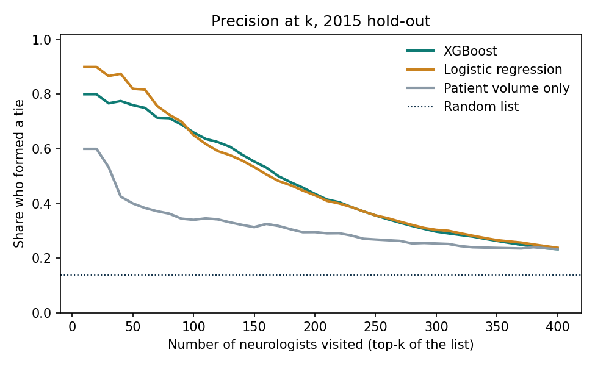
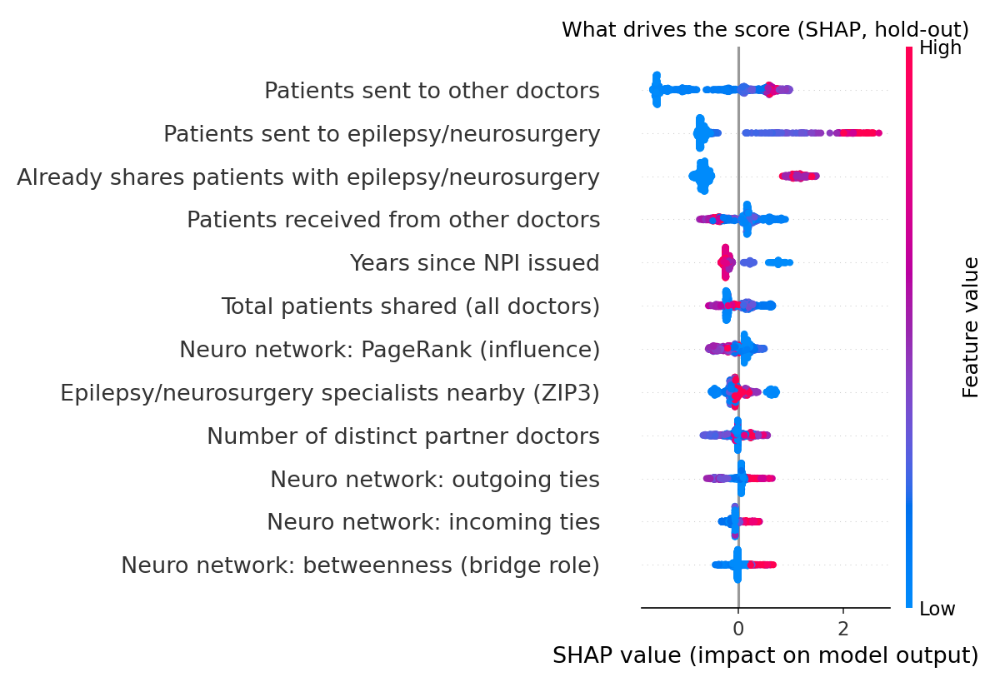
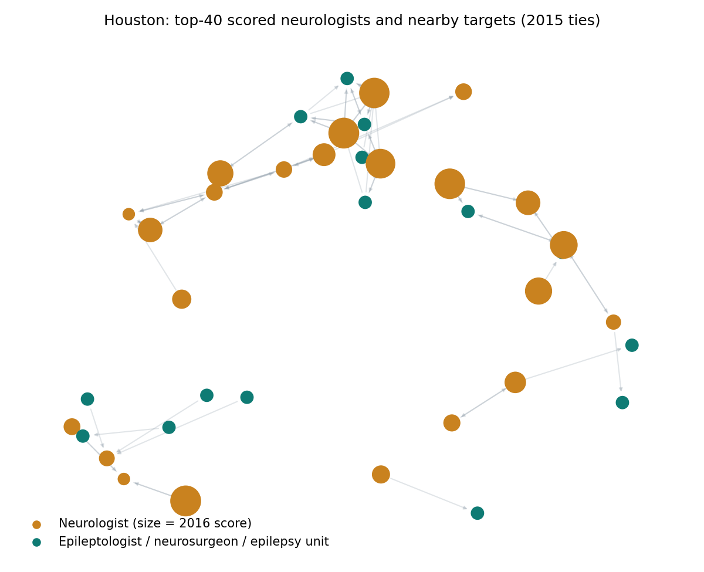

# Physician Referral Network for VNS Therapy (Texas)

**Question:** Which Texas neurologists are most likely to send patients toward an epileptologist,
neurosurgeon or hospital epilepsy unit next year? That pathway is how a patient with drug-resistant
epilepsy reaches a VNS Therapy implant. And how would a commercial team act on that list?

**Answer in one line:** On a true time-based hold-out, the model's top 100 neurologists contained
**66 who went on to form that tie**. A list ranked by patient volume alone contained 34, and a random
list would contain about 14. The strongest signal is simple: neurologists who *already* share patients
with these specialists keep doing so. A rule built on that one fact matches the model.

> Portfolio project built only on public, aggregated CMS data (no patient-level records).
> A "referral" here means a **patient-sharing tie used as a proxy for referral**, not a recorded referral order.



---

## Data (all free and public, joined on NPI)

| Source | Role | Texas size after cleaning |
|---|---|---|
| CMS Physician Shared Patient Patterns 2013-2015 (30-day window, the public DocGraph data) | Edges: provider A then provider B saw the same Medicare patient within 30 days, with at least 11 shared patients | 2.89M / 2.96M / 1.89M ties (2013 / 2014 / 2015), both providers in TX |
| NPPES NPI Registry (Nov 2026) | Nodes: name, practice ZIP, specialty taxonomy | 614,749 Texas NPIs, of which 2,651 are neurologists and 1,207 are targets |
| CMS Order and Referring (Nov 2026) | Is this NPI still eligible to refer in Medicare today? (dashboard filter only, not a model feature) | 88% of scored neurologists are eligible |

Download links and the exact specialty codes are in [data/README.md](data/README.md).

## Method

1. **Clean and join** ([src/prepare_data.py](src/prepare_data.py)). DuckDB SQL reduces the 11 GB registry
   and the 55M-row national tie files to Texas. NPIs are kept as strings, and the script checks row
   counts at each join.
2. **Graph** ([src/build_features.py](src/build_features.py)). A directed NetworkX graph of ties among
   Texas neurologists and targets (about 650 nodes per year), weighted by shared patients. It computes
   in/out-degree, weighted PageRank and betweenness (sampled with k=300).
3. **Features** (one row per active neurologist per year). The other feature groups are:
   - patient volume with all Texas doctors
   - existing ties to targets
   - geography: number of targets in the same ZIP3, and whether the doctor is in a major metro
   - provider: specialty, and years since the NPI was issued

   The cohort is neurologists with at least one Texas tie that year: 671 (2013), 701 (2014) and 666 (2015).
4. **Label.** 1 if the neurologist sends patients to a target in the **next** year's file.
5. **Time split (no leakage).** The model trains on 2013 features with 2014 labels and is tested on
   2014 features with 2015 labels. The final model is refit on both labelled years and scores 2015
   features, producing the 2016 target list.
6. **Models.** Logistic regression (log-scaled) and then XGBoost, with the same split and the same
   metrics. SHAP explains every score.

## Results (2015 hold-out, 701 neurologists, 13.8% positive)

| Model | Precision@100 | Recall@100 | ROC-AUC | PR-AUC |
|---|---|---|---|---|
| Random list | ~0.14 | - | 0.50 | 0.14 |
| Rank by patient volume | 0.34 | 0.35 | 0.79 | 0.36 |
| Rank by current ties to targets (simple rule) | **0.68** | 0.70 | 0.92 | **0.76** |
| Logistic regression | 0.65 | 0.67 | **0.93** | 0.73 |
| XGBoost | 0.66 | 0.68 | 0.92 | 0.68 |

**What complexity bought:** almost nothing on the full list. XGBoost did not beat logistic regression,
and neither model beat the one-line "already refers" rule. With about 700 rows a year and one dominant
signal, that is the honest result.

**The harder question is new referrers.** These are the 538 neurologists with no tie to a target in
2014; only 15 formed one in 2015. In its top 50, XGBoost found 6 of them, compared with 4 for the volume
ranking (PR-AUC 0.20 vs 0.09). The bootstrap 95% intervals overlap widely (0.07–0.47 vs 0.03–0.26), so
this is a lead worth testing, not a proven win.
Full tables are in [report/metrics.md](report/metrics.md) and [report/error_analysis.md](report/error_analysis.md).

**Top three drivers (SHAP):**
1. Patients sent to other doctors.
2. Patients sent to epilepsy/neurosurgery specialists.
3. Already having a tie to such a specialist.



**Calibration:** both models over-predict on 2015 (see [figures/calibration.png](figures/calibration.png)).
The positive rate fell from 24% to 14% between label years, and the 2015 public file is about 37%
smaller than 2014. Use the score to *rank* physicians, not as a literal probability, until it is
recalibrated on newer data.

**Error analysis:**
- False positives in the top 100 look just like true positives on volume, but they practise where
  there are more target specialists nearby (median 81 vs 43 in the same ZIP3). In dense markets such as
  the Texas Medical Center, referrals have many places to go.
- Child neurologists barely appear (7 active in 2015) because this data is Medicare only.

## Deliverables

- **Ranked target list:** [report/target_list_texas.csv](report/target_list_texas.csv). It covers 666
  neurologists, each with a score, the top three reasons for that score, current referral status and
  Medicare eligibility.
- **Dashboard:** `streamlit run app.py`. It has filters (metro, specialty, new opportunities only), the
  ranked table, and a physician search that shows the score, its drivers and the physician's
  patient-sharing network.
- **Stakeholder memo:** [report/memo.md](report/memo.md) (two pages, written for the commercial team).



## Limitations

- **Proxy, not referral.** Patient-sharing means two doctors saw the same patient within 30 days; it
  does not prove a referral order was written.
- **Medicare only.** Younger epilepsy patients, who matter a great deal for VNS, are under-represented;
  child neurology is nearly invisible here.
- **Old and partial data.** 2013–2015 are the latest free public years, and the 2015 file is smaller
  than the earlier ones. Pairs with fewer than 11 shared patients are suppressed by CMS.
- **Current registry for past years.** NPPES specialty and address data are self-reported and come
  from 2026, not 2014. Doctors who have since deactivated their NPI drop out.
- **Correlation is not influence.** A high score prioritises outreach; it does not show that a visit
  causes a referral.

## Run it

```bash
pip install -r requirements.txt
# put the raw files in data/raw/ (see data/README.md), then:
python src/prepare_data.py      # ~10 min: clean + join (DuckDB SQL)
python src/build_features.py    # graph + features
python src/train_evaluate.py    # models, metrics, SHAP, ranked list, figures
streamlit run app.py
```

```
app.py                  Streamlit dashboard
src/prepare_data.py     step 1-2  clean + join on NPI (SQL)
src/build_features.py   step 3-4  graph + feature table
src/train_evaluate.py   step 5-6  models, evaluation, SHAP, target list
report/                 memo, metrics, error analysis, ranked list
figures/                charts used above
data/README.md          sources and download dates
```
